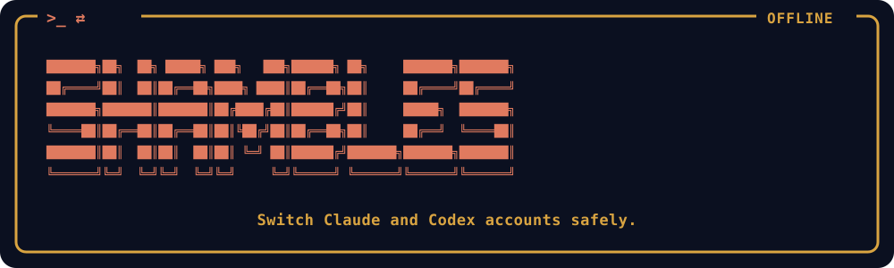

# Shambles



<details>
<summary>ASCII version</summary>

```text
╔═[ >_ ⇄ ]═════════════════════════════════════════════════════[ OFFLINE ]═╗
║                                                                          ║
║  ███████╗██╗  ██╗ █████╗ ███╗   ███╗██████╗ ██╗     ███████╗███████╗     ║
║  ██╔════╝██║  ██║██╔══██╗████╗ ████║██╔══██╗██║     ██╔════╝██╔════╝     ║
║  ███████╗███████║███████║██╔████╔██║██████╔╝██║     █████╗  ███████╗     ║
║  ╚════██║██╔══██║██╔══██║██║╚██╔╝██║██╔══██╗██║     ██╔══╝  ╚════██║     ║
║  ███████║██║  ██║██║  ██║██║ ╚═╝ ██║██████╔╝███████╗███████╗███████║     ║
║  ╚══════╝╚═╝  ╚═╝╚═╝  ╚═╝╚═╝     ╚═╝╚═════╝ ╚══════╝╚══════╝╚══════╝     ║
║                                                                          ║
║              Switch Claude and Codex accounts safely.                    ║
╚══════════════════════════════════════════════════════════════════════════╝
```

</details>

**Switch between Claude Code and Codex accounts without waiting for a
verification email.** Use a desktop window, a terminal dashboard, or a plain
CLI. Everything runs on your machine. Shambles never contacts your account.

```bash
curl -fsSL https://raw.githubusercontent.com/ianchendev/Shambles/main/scripts/install.sh | bash
shambles
```

**[Install](#install)** · **[Will it work for you?](#will-it-work-for-you)** ·
**[First five minutes](#your-first-five-minutes)** ·
**[Commands](#commands)** · **[Is it safe?](#is-it-safe)** ·
**[Troubleshooting](#troubleshooting)**

---

## Why is it called "Shambles"?

The name comes from One Piece. **Shambles** (シャンブルズ, *shanburuzu*) is one
of Trafalgar Law's abilities. He marks out an area, picks two things inside
it, and makes them trade places at once. Neither one travels the distance
between them. Each just ends up where the other was.

This tool does that with your logins. Work and Personal trade places in an
instant, and neither account has to sign in again.

---

## The problem

Claude Code reads its config from `~/.claude` and nowhere else. The VS Code
extension ignores environment variables. So there is no supported way to keep
two accounts. Codex has the same limit: `~/.codex/auth.json` holds one account.

Shambles gives each account its own folder and swaps a single file into place.

```text
   ~/.shambles/                                    what the vendor reads
   │
   ├── claude/
   │   ├── Work/     credentials.json ─────┐
   │   │             account.json          ├──► ~/.claude/.credentials.json
   │   ├── Personal/ credentials.json ─────┘     ~/.claude.json  (identity key
   │   │             account.json                                 only, spliced)
   │   └── active  → "Work"
   │
   └── codex/
       ├── Personal/ credentials.json ─────────► ~/.codex/auth.json
       └── active  → "Personal"

   Everything else in ~/.claude stays put: projects/, plugins/,
   settings.json, file-history/. Every account shares them, which is
   how Claude Code works on its own.
```

Adding an account opens your browser. Shambles does not handle that part. It
runs the vendor's own `claude auth login` or `codex login`, and those commands
do the whole sign-in.

**Why you skip the email wait.** The verification email belongs to the *first*
sign-in only. After that, a **refresh token** keeps you logged in, and each
use mints a new one with a fresh deadline. Shambles saves that token per
account, so later switches are instant. An account needs a new email only if
you leave it unused until its deadline passes.

That deadline varies, so Shambles reads your real value instead of guessing.
Samples ranged from about 4 days (macOS, Max 5x) to about 28 days (Linux,
Team). See [the evidence](docs/token-storage.md). An account you use often
never gets close.

Rate limits still apply per account, on the vendor's servers. Switching gives
you the other account's quota. It does not pool or stretch anyone's limit.

---

## Install

**One command.** The script picks the right binary for your OS and CPU from
the latest [Release](https://github.com/ianchendev/Shambles/releases) and puts
it in `~/.local/bin`. No sudo, nothing to build.

```bash
curl -fsSL https://raw.githubusercontent.com/ianchendev/Shambles/main/scripts/install.sh | bash

# or pin a release
curl -fsSL https://raw.githubusercontent.com/ianchendev/Shambles/main/scripts/install.sh | bash -s v2.1.0
```

**Windows PowerShell** installs `shambles.exe` and its windowed twin
`shamblesw.exe` into `%LOCALAPPDATA%\Shambles`, and adds that to your user
PATH:

```powershell
irm https://raw.githubusercontent.com/ianchendev/Shambles/main/scripts/install.ps1 | iex
```

That line works in Windows PowerShell 5.1 and PowerShell 7, at the default
execution policy. From `cmd.exe`, wrap it:

```bat
powershell -NoProfile -ExecutionPolicy Bypass -Command "irm https://raw.githubusercontent.com/ianchendev/Shambles/main/scripts/install.ps1 | iex"
```

To pin a release, set `$env:SHAMBLES_VERSION = 'v2.1.2'` before the line.

Three things to know first:

1. The binaries are **unsigned**, so Windows SmartScreen warns you the first
   time, and some antivirus products quarantine unsigned single-file programs
   outright. If the file vanishes after download, that is what happened; use
   pipx below instead.
2. Both scripts check the download against the release's `SHA256SUMS` and
   refuse to install on a mismatch. That list is served from the same place
   as the binary, so it catches a broken download, not a tampered release.
3. Both scripts run the binary once before installing it. If it cannot start
   on your system, nothing is installed and the script says why.

### Check it worked

```bash
shambles --version
```

A version number means you are done. Anything else, in order of likelihood:

**`shambles` is not recognized** (PowerShell) or **command not found** (bash).
The binary is installed; your shell has not noticed yet.

- **Windows.** Open a new PowerShell window. Windows stores the PATH change
  in your user profile, and only terminals opened afterwards read it. To fix
  the window you are already in:
  ```powershell
  $env:Path += ";$env:LOCALAPPDATA\Shambles"
  ```
- **Linux and macOS.** Put `~/.local/bin` on your PATH:
  ```bash
  export PATH="$HOME/.local/bin:$PATH"
  ```
  Add that line to `~/.bashrc` or `~/.zshrc` so it survives a reboot.

**`libc.so.6: version 'GLIBC_2.xx' not found`.** Your Linux is older than the
binary supports. Shambles needs glibc 2.35 or newer, which means Ubuntu 22.04
or later, or Debian 12 or later. Check with `ldd --version`. On anything
older, install with pipx below, which needs no matching system libraries.

**Windows SmartScreen blocks it.** Expected for an unsigned publisher. Choose
*More info*, then *Run anyway*, or use pipx instead.

<details>
<summary><strong>Other ways to install</strong></summary>

**pipx.** No unsigned binary, and it works the same on Linux and inside WSL:

```bash
sudo apt install python3-tk                              # only for the window
pipx install git+https://github.com/ianchendev/Shambles
shambles
```

**A binary from [Releases](https://github.com/ianchendev/Shambles/releases).**
One file, nothing to install. Same unsigned caveat.

**From a clone.** Textual is a real dependency, so a bare checkout will not
run until you install it:

```bash
git clone https://github.com/ianchendev/Shambles && cd Shambles
python3 -m venv .venv
.venv/bin/pip install -e .
.venv/bin/shambles
```

You need **Python 3.10 or newer**. Some distributions still ship 3.8, Ubuntu
20.04 among them. There, name the interpreter yourself:
`python3.12 -m venv .venv`. On an older one Shambles stops with a clear
message instead of a syntax error from deep inside the package.

`python3 shambles.py` also works, once the dependency is on that interpreter's
path.

**Not on npm yet.** `npm install -g shambles` fails today. A launcher package
is designed and waiting on the macOS and Windows credential work below.

</details>

### Will it work for you?

| Where you run it | Claude Code | Codex |
|---|---|---|
| Linux desktop | **Works.** In daily use, and checked by CI | **Works in CI** |
| WSL (Ubuntu and friends) | **Works**, using the **Linux** build **inside** WSL | **Works in CI** (as Linux) |
| macOS 15 and 26, Apple Silicon and Intel | **Works in CI** | **Works in CI** |
| Windows, not WSL, x64 and Arm | **Works in CI** | **Works in CI** |

**What "works in CI" means, exactly.** On throwaway GitHub machines with the
current Claude Code and Codex installed and made-up credentials, Shambles
saved two accounts, switched, switched back and cleared the login. After each
step the vendor's own command (`claude auth status`, `codex login status`)
was asked who was signed in, and named the account Shambles had just put
there. That runs on every pull request, from source and from the released
binary, on macOS 15 and 26, Windows Server 2022 and 2025, Windows 11 on Arm
and Linux.

**What it does not mean.** Nobody has yet signed in with a real account
through Shambles on macOS or native Windows, and nobody has used Codex with a
real account on any system. Signing in is the vendor's own command, which
Shambles only starts, so there is little of ours to go wrong, but it has not
been seen to work. If you try it, please
[say how it went](https://github.com/ianchendev/Shambles/issues), either way.

**macOS.** Claude Code keeps its login in the Keychain. When the Keychain
refuses a write, which is what happens over SSH, it uses
`~/.claude/.credentials.json` instead. Shambles follows both. With the
Keychain locked and no file to fall back on, it says the Keychain is locked
instead of guessing that you are signed out.

**Windows.** Claude Code keeps its login in
`%USERPROFILE%\.claude\.credentials.json`. It also has a Credential Manager
store that Anthropic is switching on account by account. Shambles reads the
same switch Claude Code reads and follows it. Versions up to 2.1.2 used
Credential Manager regardless, in a layout Claude Code does not read, so a
switch on Windows changed the name on screen and left the old login in place.
Upgrade before using it there.

**Codex.** Shambles swaps `~/.codex/auth.json`, the same path on every
system. That only works while Codex keeps its login in that file, which is
its default. If your `config.toml` sets `cli_auth_credentials_store` to
`keyring` or `auto`, Codex does not read the file, and Shambles refuses to
switch and tells you the line to change.

**Never sign out, or sign in by hand, while a saved account is the live
one.** `codex login`, `codex logout`, `claude auth logout` and `/logout` all
tell the vendor's servers to revoke the login that is currently stored. The
copy Shambles saved is the same login, so it dies too, and that account then
needs a new verification email. To add an account, use **Add Account**: it
empties the live slot first, so there is nothing for the vendor to revoke.

**WSL is the sharp edge.** A Windows `.exe` manages `C:\Users\<you>\.claude`.
That is a *different* Claude Code install from the one in your WSL home
directory. If you use Claude Code inside WSL, install Shambles inside WSL.
WSL also puts the Windows PATH after its own, so `claude` inside WSL can turn
out to be the Windows program. `shambles doctor` tells you if it is.

**What cannot work, and what Shambles says instead.**

| Situation | What happens |
|---|---|
| `ANTHROPIC_API_KEY`, `ANTHROPIC_AUTH_TOKEN`, `CLAUDE_CODE_OAUTH_TOKEN` or a Bedrock, Vertex or Foundry switch is set; or `CODEX_ACCESS_TOKEN` or `CODEX_API_KEY` for Codex | The vendor signs in from the variable and ignores its stored login. A switch succeeds and changes nothing. `shambles doctor` names the variable |
| Codex set to `keyring`, `auto` or `ephemeral` storage | Shambles refuses to switch Codex and names the setting |
| Claude inside WSL is really the Windows install | `shambles doctor` says so. Install Claude Code inside WSL, or use Shambles for Windows |
| `CLAUDE_CONFIG_DIR` or `CODEX_HOME` set in a shell | Shambles started from that shell manages that directory. Programs started without the variable, VS Code from the desktop for one, use the default directory and are not affected. A banner and `shambles doctor` both say so |
| A Mac's Keychain is locked and there is no fallback file (some SSH sessions) | Shambles reports the Keychain as locked. Unlock it with `security unlock-keychain`, or run Shambles at the Mac itself |
| The Claude desktop app, and ChatGPT's own chat login | Separate logins that Shambles does not manage |
| Alpine and other musl systems, or glibc older than 2.35 | The binaries cannot start. The install script says so before downloading; install with pipx |
| 32-bit Windows | No binary. Install with pipx |

If a switch seems to do nothing, run this first:

```bash
shambles doctor
```

It checks the machine without changing anything and lists what would stop a
switch taking effect.

### Try it without risking your real accounts

Every command takes `--home`, which points the whole program at another
directory. Shambles reads and writes nothing outside it. That includes the
macOS Keychain and the Windows Credential Manager, which belong to you and
not to a directory: for any home but your real one, only files are used.

```bash
shambles list --home /tmp/scratch      # an empty pretend home
shambles gui  --home /tmp/scratch      # the window, against nothing real
```

---

## Your first five minutes

**1. Save the account you are signed in as now.** Open the window
(`shambles gui`) or the dashboard (`shambles`). Your current login appears
with a **Save …** button, labelled with the address it found. Click it and
name the profile `Work`. Nothing moves and nothing is deleted.

**2. Add your second account.** Click **＋ Add Account**, pick the provider,
and name it `Personal`. Shambles creates the profile, makes it active, then
runs the vendor's login command while your browser opens. This is the only
time you wait for that account's email.

**3. Switch.** Every account except the live one has a **Switch** button.
Click it, then **start a new session**. A Claude Code process that is already
running keeps the token it loaded at startup. In VS Code, run
*Developer: Reload Window*.

That is the whole loop. From here on, switching takes one click or one key.

---

## Commands

Running `shambles` with no arguments opens the terminal dashboard, as long as
stdin *and* stdout are both a real terminal. Piped or scripted, it prints
usage and changes nothing.

| Command | What it does |
|---|---|
| `shambles` | The terminal dashboard, on a real terminal |
| `shambles tui` | The terminal dashboard, always |
| `shambles gui` | The desktop window |
| `shambles list` | Every account and its state, as text |
| `shambles list --json` | The same thing, for scripts |
| `shambles switch <provider> <account>` | Switch without opening anything |
| `shambles doctor` | Check whether switching can work on this machine, and say why not. Changes nothing. Exits 1 if it finds a problem |
| `shambles doctor --json` | The same findings, for scripts |
| `shambles config get update.check` | Prints `true` or `false` |
| `shambles config set update.check true` | Turn release notices on or off |
| `shambles --version` | The version, one line on stdout |
| `shambles --help` | The usage message |

Two flags work anywhere, before or after the command. `--home <dir>` uses
`<dir>` instead of your home directory. `--no-motion` turns off optional
terminal animation, and `SHAMBLES_NO_MOTION=1` does the same.

Exit codes: **0** worked, **1** refused or failed, **2** the command line was
wrong. A failure reason goes to stderr, or into the JSON if you asked for
`--json`.

```console
$ shambles list
Claude Code  (Terminal, VS Code)
    Personal       personal@example.test  ·  claude_pro  ·  needs login
  * Work           work@example.test  ·  claude_max  ·  session 22%  ·  week 58%

Codex  (Terminal, VS Code, ChatGPT)
  * Personal       alex@example.test  ·  plus

$ shambles switch claude Personal
Switched claude to Personal.
  Run 'claude auth login' in a terminal.
```

The `*` marks the live account. `--json` prints the same data the window and
the dashboard draw from, so you can tell a display bug from a logic bug.

---

## The two interfaces

### The window

`shambles gui` opens a fixed 860 px window. Its height grows with your
accounts up to 80% of your screen. No menu bar, no toolbar, no right-click
menu. Everything sits on screen.

```text
┌──────────────────────────────────────────────────────────────────┐
│ CLAUDE CODE                                    [ Save … ]        │  ← group heading:
│ Work                                                             │       provider, live profile,
│ work@example.com                                                 │       and what it found
│                                                                  │
│ ┃ Work                                                           │  ← the live account: blue
│ ┃ work@example.com                                               │       spine and tint, and
│ ┃ session ▓▓▓▓▓▓░░░░░░░░░░░░░░░░░  22% ⓘ                         │       no buttons at all
│ ┃ week    ▓▓▓▓▓▓▓▓▓▓▓▓▓▓░░░░░░░░░  58% ⓘ                         │
│                                                                  │
│ │ Other                       [ Switch ]   ✕                     │  ← every other card
│ │ other@example.com                                              │
│                                                                  │
│ │ Personal                    [ Sign in ]  ✕                     │  ← a lapsed one signs
│ │ personal@example.com   needs login                             │       in instead
│                                                                  │
│ CODEX                                                            │
│ Personal                                                         │
│ alex@example.com                                                 │
│                                                                  │
│ ┃ Personal                                                       │
│                                                                  │
├──────────────────────────────────────────────────────────────────┤
│ ⟳                            [ Eject ]   [ + Add Account ]       │  ← footer, always there
└──────────────────────────────────────────────────────────────────┘
```

The live card has **no buttons at all** while its login is healthy, and never
a ✕, so you cannot delete the login you are using by misclicking.

A card whose login has lapsed shows **Sign in** where Switch would be, the
live card included. It runs the vendor's own browser sign-in with the
address filled in (Claude), saves the new login under the same profile and
leaves it live, so there is no need to remove the account and add it back.
Cancel, and you are put back on the account you were using.

Each card shows a state chip only when something needs you:

| Chip | Meaning |
|---|---|
| *(nothing)* | Healthy, or an expiry it cannot read |
| `soon` (amber) | The refresh window closes within a day (Claude) or two (Codex) |
| `needs login` (red) | The window closed, or this profile has no credential yet. Press **Sign in** |
| `signed out` (red) | The login was cleared. The profile survives, the token is empty |

Usage bars come from what the vendor already wrote to your disk, never from a
request. They turn red at 80%, and anything older than an hour goes dim and
gets labelled `as of 20m ago`.

Every control, the add-account walkthrough, and the two migrations the window
runs on its own are in [docs/how-it-works.md](docs/how-it-works.md).

**A redesigned window is in preview.** `shambles gui --new` opens it. It does
everything above in one resizable window with no separate dialogs, adds light
and dark themes, and can be driven from the keyboard (`1` to `9` switch,
`/` filters, `Ctrl+N` adds).

It is built on Qt, a 36 to 82 MB download depending on the platform, so it
ships as its own archive
beside the `shambles` binary instead of inside it. The install scripts fetch
it for you into `~/.local/share/shambles/window` (or
`%LOCALAPPDATA%\Shambles\window`); set `SHAMBLES_NO_WINDOW=1` first to skip
it. It carries the system libraries Qt needs, so there is nothing to
`apt install`.

The scripts also put Shambles in your applications menu: a launcher entry on
Linux and a Start menu shortcut on Windows. `SHAMBLES_NO_DESKTOP=1` skips
that. On macOS the window is a plain folder for now, with no entry in
Launchpad.

From pip or pipx it is an optional extra instead:

```bash
pip install 'shambles[gui]'      # or: pipx inject shambles PySide6-Essentials
shambles gui --new
```

Installed that way on a bare Linux or WSL machine, Qt needs three system
libraries and says so if they are missing: `sudo apt install libegl1
libxcb-cursor0 libxkbcommon-x11-0`.

**Licences in the window.** The window archive contains Qt and Qt for
Python (PySide6), which are LGPL-3.0, alongside Shambles' own MIT code. Qt
is kept as separate shared libraries inside the folder, unmodified, so you
can replace it with your own build. The archive's `licenses` folder holds
the LGPL-3.0 and GPL-3.0 texts, a notice saying where Qt's source is, the
SIL Open Font License for the bundled Inter typeface, and Shambles' MIT
licence. Python (PSF), Textual and Rich (MIT) and the PyInstaller bootloader
(GPL with a bundling exception) are listed there too. The small `shambles`
binary contains no Qt.

Because the window's QML engine is linked against Qt's own C++ network
library, that library is inside the window archive. Nothing in Shambles
calls it: the window loads only files that ship with it, and the rule that
no Python module in the package imports a network module is still enforced
by `tests/test_login.py`.

### The terminal dashboard

`shambles` opens a keyboard dashboard instead of the window whenever you run
it on a real terminal. No `DISPLAY`, no Tk, and it works the same over SSH.

| Key | Action |
|---|---|
| `j` / `k` or `↓` / `↑` | Move between accounts |
| `Enter` | Switch to the selected account |
| `a` | Add. Pick a provider and name in an overlay |
| `l` | Log in the selected account |
| `m` | Account menu: save the current login, rename, remove |
| `x` | Eject, see [Leaving cleanly](#leaving-cleanly) |
| `r` | Refresh |
| `u` | Dismiss the update notice |
| `?` | Help |
| `Esc` / `q` | Close whatever is open, or quit |

**Signing in from here.** When the vendor prints a sign-in link, which is what
happens over SSH and under WSL, that link gets its own panel. Press `o` to
open it or `c` to copy it. Copying uses OSC 52, so the link reaches the
clipboard of the machine you are sitting at, even across SSH. Pressing `o`
copies it too, because the WSL openers report success while doing nothing.

**Launch straight into the vendor CLI.** After a successful switch, the result
screen offers **Launch**. It closes the dashboard and replaces the Shambles
process in place with `claude` or `codex`. No second window opens. The
terminal you ran `shambles` in becomes the vendor CLI's terminal, already
signed in as the account you just picked.

**Colour and motion.** `NO_COLOR` ([the convention](https://no-color.org)) is
detected on its own and makes everything monochrome. `SHAMBLES_MOTION=0` and
`SHAMBLES_SCALE` (1.0 to 4.0) adjust the window.

---

## Update checks

**Off by default**, and off means off. With the setting unset, no part of
Shambles makes a network call of any kind. Nothing here reports usage or
phones home under any setting.

```bash
shambles config set update.check true     # turn it on
shambles config set update.check false    # turn it off
```

Turning it on means at most one unauthenticated `GET` per day, to the public
GitHub Releases endpoint for this repository. Shambles reads one field: the
tag of the latest release. No token, no account, no machine ID and no query
string go with it, so nothing in the request says who you are. The only thing
kept is `~/.shambles/update-cache.json`, holding that tag and the lookup time.

A failed lookup still uses up the day's attempt. That way an offline machine
does not sit through a timeout on every start. It stays silent instead of
showing you an error.

**It never downloads or replaces anything.** The whole feature is one sentence
telling you a newer version exists. It shows up at the bottom of the terminal
dashboard, where `u` dismisses it. It also shows up on `shambles --version`,
printed to stderr from the cache, so stdout stays one line for scripts. The
window shows no notice and does no lookup.

---

## Is it safe?

**It runs entirely on your machine and cannot touch your Claude or OpenAI
account.** Shambles cannot reach Anthropic's or OpenAI's servers at all, so it
cannot affect your login, billing, rate limits or organisation. It moves bytes
between directories on your own disk.

The one module that may open a socket is `shambles/update_check.py`, and only
after you enable [update checks](#update-checks). That split is not a promise.
`tests/test_login.py` walks the syntax tree of every module and fails the
build on any networking import, allowing `urllib` in that one file and nowhere
else.

**It runs two kinds of external program.** The vendor's own login command,
when you add or renew an account. And, on macOS only, `/usr/bin/security`,
the system tool Claude Code itself uses to read and write its Keychain item.
**Shambles implements no part of signing in.** That command opens your browser and runs its own callback
server. Shambles waits for it to finish, then files the credential it wrote.
No password, no token in flight, and nothing held that was not already on your
disk.

**Your session history is shared.** Transcripts live in `~/.claude/projects/`,
filed by project path rather than by account, and Shambles leaves that
directory alone. Every account sees every session. Versions before 1.0 got
this wrong, and Shambles repairs that the next time you open the window.

**The one real caveat: do not switch while a Claude Code session is running.**
A live session holds its token in memory and rewrites `~/.claude.json` from
time to time. If it writes after Shambles does, the last writer wins and your
spliced identity is gone. The backups cover you. The clean habit is to finish
or close your sessions, switch, then start fresh.

The full list of what protects your data, and what a switch does step by step,
is in [docs/how-it-works.md](docs/how-it-works.md).

---

## Leaving cleanly

Do **not** uninstall by deleting `~/.shambles/`. That folder holds the refresh
token for every account you saved, and each one comes back only through a
fresh verification email.

Use **Eject** instead: the footer button in the window, or `x` in the
dashboard. It leaves `~/.claude` exactly as a stock install expects, still
signed in as your current account, with history, plugins and settings
untouched. It removes only Shambles' own bookkeeping and never deletes a
credentials file. Afterwards, remove the program:

```bash
rm ~/.local/bin/shambles        # installed with the script
pipx uninstall shambles         # installed with pipx

# and, once you are sure you want the saved logins gone for good
rm -rf ~/.shambles
```

**Removing one account.** Each inactive profile has a **✕** next to its Switch
button. Confirming deletes that profile's directory and the refresh token
inside it, so that account needs a fresh login and its email to come back.
Session history, plugins and settings are shared and live elsewhere.

---

## Troubleshooting

| Symptom | Cause and fix |
|---|---|
| `No module named 'textual'` | A clone whose dependencies were never installed. Run `pip install -e .` in the checkout, or use pipx |
| `Shambles needs Tkinter` | Only the window needs it. Run `sudo apt install python3-tk`, or use `shambles tui` instead |
| `shambles: command not found` after the install script | `~/.local/bin` is not on your PATH. The script prints the line to add |
| Switching seems to do nothing | A session that was already running keeps its old token. Start a new one, or run *Developer: Reload Window* in VS Code |
| Switching does nothing, even in new sessions | Run `shambles doctor`. The usual causes are an environment variable supplying its own login, `CLAUDE_CONFIG_DIR` set in one place and not another, or Shambles 2.1.2 or older on Windows. See [the support table](#will-it-work-for-you) |
| `Codex is set to keep its login in the system keyring` | Codex is not using `auth.json`, so there is nothing for Shambles to swap. Set `cli_auth_credentials_store = "file"` in `~/.codex/config.toml` and sign in again |
| `The macOS Keychain is locked` | Usually an SSH session. Run `security unlock-keychain`, or use Shambles at the Mac itself |
| An account needs a new login right after you signed out of another | Signing out revokes the stored login on the vendor's servers, and Shambles' saved copy is the same login. Use **Add Account** instead of signing out |
| The window will not close | `Ctrl+C` in the launching terminal works, and so does `kill <pid>`. If it is stopped rather than frozen, run `pkill -CONT -f shambles && pkill -f shambles` |
| A provider is greyed out in Add Account | Its CLI is not on your PATH. Shambles runs the vendor's own login command, so it needs `claude` or `codex` installed |
| Windows SmartScreen warns you | The binaries are unsigned. Use pipx if you would rather not click through it |
| PowerShell says `The term 'shambles' is not recognized` | The install worked; this terminal predates it. Open a new PowerShell window, or run `$env:Path += ";$env:LOCALAPPDATA\Shambles"` |
| `libc.so.6: version 'GLIBC_2.38' not found` | A 2.1.0 Linux binary, which was built on too new a system. Upgrade to 2.1.1 or later, or install with pipx |
| On Windows, `'NoneType' object has no attribute 'write'` | The 2.1.0 Windows binary had no console to print to. Upgrade to 2.1.1 or later |

---

## Development

```bash
python3 -m venv --system-site-packages .venv
.venv/bin/pip install -e ".[dev]"
.venv/bin/python -m pytest
```

Around 1,000 tests. Every one runs against a synthetic home in `tmp_path`, so
none reads or writes your real `~/.claude`. Nothing runs a real `claude` or
`codex` either. The login tests drive a `/bin/sh` stand-in on `PATH`, so no
browser opens and nothing authenticates.

CI runs the suite on Linux and Windows across Python 3.10 and 3.12, and on
macOS, under `xvfb` on Linux so the window tests run instead of skipping.

A second workflow, `real-machine`, answers what the suite cannot from behind
its fakes. On macOS, Windows and Linux runners it installs the current Claude
Code and Codex, then drives Shambles against the real Keychain and the real
Credential Manager with made-up credentials, and asks the vendors' own
commands who is signed in after each switch. It also runs both install
scripts for real. It runs on every pull request and once a week, so a vendor
moving its login is noticed without anyone opening a pull request.

Tagging `v*` builds unsigned binaries for six targets: Linux x86_64 and
arm64, macOS Intel and Apple Silicon, and Windows x64 and arm64. It attaches
them to a Release with a `SHA256SUMS` file. Each binary is built only after
the suite passes on that platform, and nothing is published unless all six
build.

The load-bearing test is
`tests/test_switch.py::test_credentials_survive_a_round_trip_unmodified`. It
asserts that `Work → Personal → Work` leaves the credential byte-identical,
refresh token and expiry included. If it regresses, the tool stops solving the
problem it exists for.

Developed on WSL2 Ubuntu with WSLg, Python 3.12, Tk 8.6. macOS and native
Windows are exercised by the `real-machine` workflow and by nobody's daily
use yet; see [the support table](#will-it-work-for-you) for exactly what
that does and does not establish.

See [CONTRIBUTING.md](CONTRIBUTING.md) before opening a pull request.

---

## Documentation

| Document | What it is |
|---|---|
| [docs/how-it-works.md](docs/how-it-works.md) | The mechanism: what a switch does, what it touches, token expiry, the window in detail, desktop shortcuts |
| [TECH_SPEC.md](TECH_SPEC.md) | Architecture reference. Its §-numbered mechanism is authoritative. Its single-provider paths describe v1.0 and are superseded |
| [docs/token-storage.md](docs/token-storage.md) | Field research into how Claude and Codex store credentials on macOS, Windows and Linux |
| [docs/design-decisions.md](docs/design-decisions.md) | Recorded decisions and reasoning |
| [SECURITY.md](SECURITY.md) | The security posture, and the one opt-in network call |
| [CONTRIBUTING.md](CONTRIBUTING.md) | How to report a bug, and what a change needs |

Where two documents disagree about what the tool does today, TECH_SPEC wins on
mechanism: switch ordering, atomic writes, permissions, the state machine,
concurrency.

The tests win over both.
